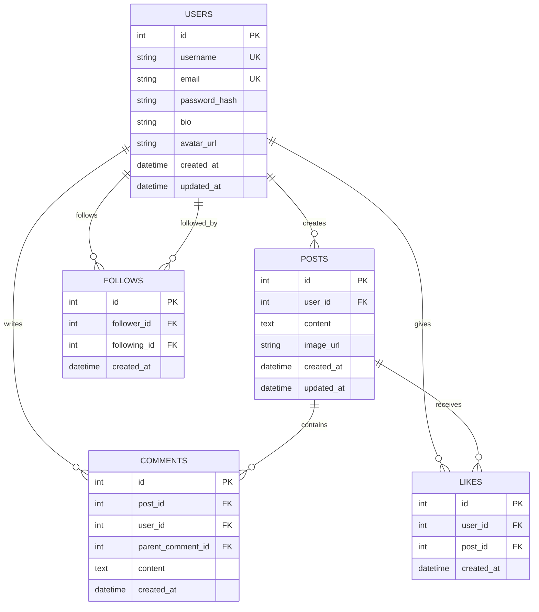

# Mini Social Media Web Platform — Design Specification

**Date:** 2026-10-19  
**Status:** In Review  
**Audience:** Full-Stack Engineers & Project Stakeholders  

---

## 1. Intent & Purpose

The goal of this project is to deliver a complete, production-grade mini social media web platform that demonstrates end-to-end full-stack mastery:
- Relational schema modeling with referential integrity and strict constraints.
- A secure, versioned Express.js REST API (`/api/v1`) with JWT authentication, bcrypt password hashing, and layered architecture (`routes` → `controllers` → `services`).
- A responsive, accessible frontend with modern CSS, dynamic Dark/Light theme switching, and instant visual feedback.
- A seamless onboarding loop where visitors can immediately browse public media posts, but attempting to interact (like, comment, follow, post) routes them to a dedicated registration screen with return redirection.

---

## 2. Goals, Non-Goals & Anti-Goals

### 2.1 Goals
- **Zero-Setup Quickstart:** Any developer can clone the repo, run `npm install`, `npm run seed`, and `npm start`, and immediately interact with realistic sample data.
- **Full Core Loop:** Register, log in, browse media feed, switch between "Explore" and "Following" tabs, publish image/text posts, like (exactly once per user), add comments, follow/unfollow users, and view profile stats.
- **Media Upload Pipeline:** Support local file uploads via `multer` (with mime-type checking and file size bounds) served as static assets, supporting responsive image cards.
- **Architectural Separation:** Clean separation of concerns with unified API error responses (`{ success: false, error: { message, code } }`).
- **Automated Verification:** Comprehensive test suite covering critical paths (auth, feed filtering, like constraints, follow rules, post creation).

### 2.2 Non-Goals
- Real-time WebSockets / live streaming (standard HTTP polling/revalidation is sufficient).
- Multi-tier nested comment replies (strictly single-level threaded replies or direct post comments).
- OAuth 2.0 third-party social logins (Google/GitHub) — focused on standard JWT + bcrypt email/username auth.
- Cloud object storage (AWS S3) configuration — local filesystem storage with static serving keeps the repo self-contained and runnable offline.

### 2.3 Anti-Goals (What would make this a failure)
- Tutorial-spaghetti code where database queries and business logic reside directly in route files.
- Storing unhashed or weak passwords.
- Allowing duplicate likes from the same user or self-following.
- Missing responsive design or broken layouts on mobile devices.
- Reliance on external CDN dependencies that fail when running offline.

---

## 3. User Flows & Experience

### 3.1 Visitor / Guest Experience
1. **Landing:** Visitor arrives at `/` and immediately sees the **Explore** tab populated with image + text posts from all users.
2. **Interaction Gating:** When an anonymous visitor clicks the Like button, Comment box, Follow button, or "Create Post" button:
   - The application preserves the intended target and navigates to `/register?redirect=<target>&reason=interact`.
   - The registration page displays a friendly banner: *"Create an account or log in to like, comment, and connect."*
3. **Post-Auth Return:** Upon successful registration or login, the user is automatically redirected back to the post or feed they were viewing.

### 3.2 Authenticated Experience
1. **Home Feed Tabs:**
   - **Explore:** Global chronological stream of public posts.
   - **Following:** Filtered stream containing only posts published by users the current user follows.
2. **Publishing Posts:**
   - Text textarea (up to 500 characters) + optional image file picker with instant client-side preview.
   - On submission, uploads via `multipart/form-data`, validates image dimensions/types, and prepends to feed without full page refresh.
3. **Engaging:**
   - **Like:** Instant optimistic UI update toggling active heart state and incrementing counter; sends `POST /api/v1/posts/:id/like` or `DELETE /api/v1/posts/:id/like`.
   - **Comment:** Inline comment drawer/section displaying comments with author avatar and timestamp.
4. **Social & Profiles:**
   - User profile displays username, bio, joined date, follower count, following count, and their published posts.
   - Follow/unfollow toggle button (hidden on self-profile).
5. **Theme Switching:**
   - One-click toggle switch between Dark and Light mode, persisting preference in `localStorage` and adapting to `prefers-color-scheme`.

---

## 4. Technical Architecture

### 4.1 Backend Stack & Modules
- **Runtime:** Node.js (v18+) & Express.js.
- **Database:** SQLite via Sequelize ORM (or Prisma / Better-sqlite3 with migrations and models).
- **Authentication:** JWT tokens (stored securely in `localStorage` or `httpOnly` cookies) + `bcryptjs` (salt rounds: 10).
- **Uploads:** `multer` configured with a 5MB size limit and whitelist for `image/jpeg`, `image/png`, `image/webp`.
- **Validation:** Express validator or Joi / Zod for strict schema validation on all incoming payload bodies.

### 4.2 Data Models & Schema

#### Referential Constraints & Indexes:
- `LIKES`: Unique composite constraint `(user_id, post_id)` to ensure idempotency.
- `FOLLOWS`: Unique composite constraint `(follower_id, following_id)` and database check constraint `follower_id != following_id`.
- Indexes on `POSTS(user_id, created_at)`, `COMMENTS(post_id, created_at)`, and `FOLLOWS(follower_id, following_id)`.

### 4.3 REST API Endpoints (`/api/v1`)

| Method | Endpoint | Auth | Purpose |
|---|---|---|---|
| POST | `/auth/register` | Public | Register new user account |
| POST | `/auth/login` | Public | Authenticate and return JWT token |
| GET | `/auth/me` | User | Get current authenticated profile |
| GET | `/posts` | Public | List posts (query: `tab=explore\|following`, `page`, `limit`) |
| POST | `/posts` | User | Create a new post (text + optional image upload) |
| GET | `/posts/:id` | Public | Get single post details with comments |
| DELETE | `/posts/:id` | User | Delete post (author only) |
| POST | `/posts/:id/likes` | User | Like a post |
| DELETE | `/posts/:id/likes` | User | Unlike a post |
| GET | `/posts/:id/comments` | Public | Get post comments |
| POST | `/posts/:id/comments` | User | Add comment to post |
| GET | `/users/:username` | Public | Get user profile and stats |
| PUT | `/users/profile` | User | Update bio and avatar |
| POST | `/users/:id/follow` | User | Follow user |
| DELETE | `/users/:id/follow` | User | Unfollow user |

### 4.4 Frontend Architecture
- **Structure:** Vanilla HTML5, modern modular CSS (CSS variables for theming, CSS Grid, Flexbox), and clean ES6+ JavaScript modules.
- **Routing:** Lightweight client-side hash or HTML5 history router handling views (`/`, `/explore`, `/login`, `/register`, `/profile/:username`).
- **State & API Client:** Centralized `api.js` client handling bearer token injection, automated 401 handling, and unified error handling.

---

## 5. Left to the Builder
- Selection of specific ORM (e.g. Sequelize vs Prisma vs Better-SQLite3 with SQL migrations — Sequelize or Prisma recommended for clear schema declarative models).
- Exact test runner selection (e.g., Jest + Supertest for backend integration tests).
- Seed script mock data details (realistic profile names, sample photos, engaging social blurbs).
